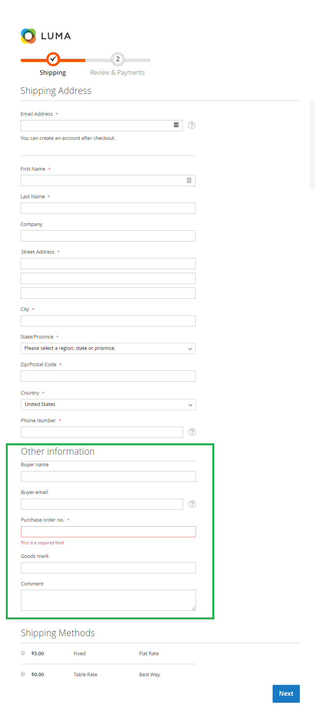
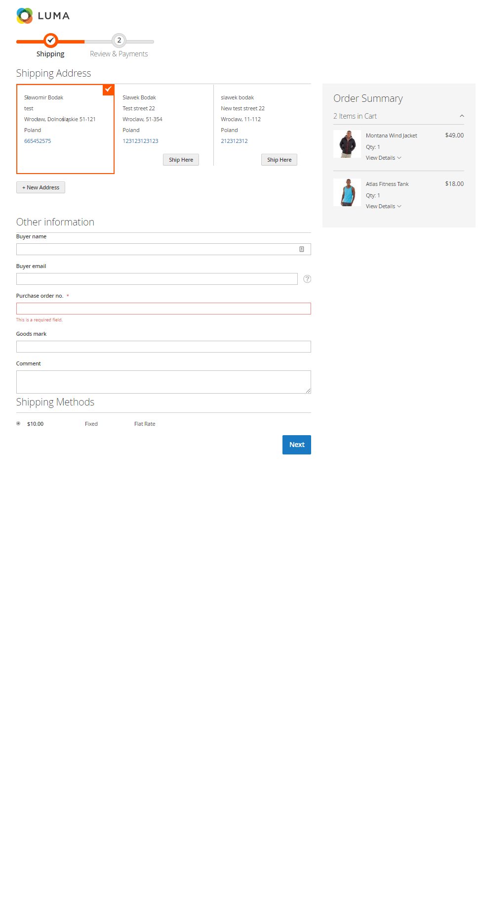
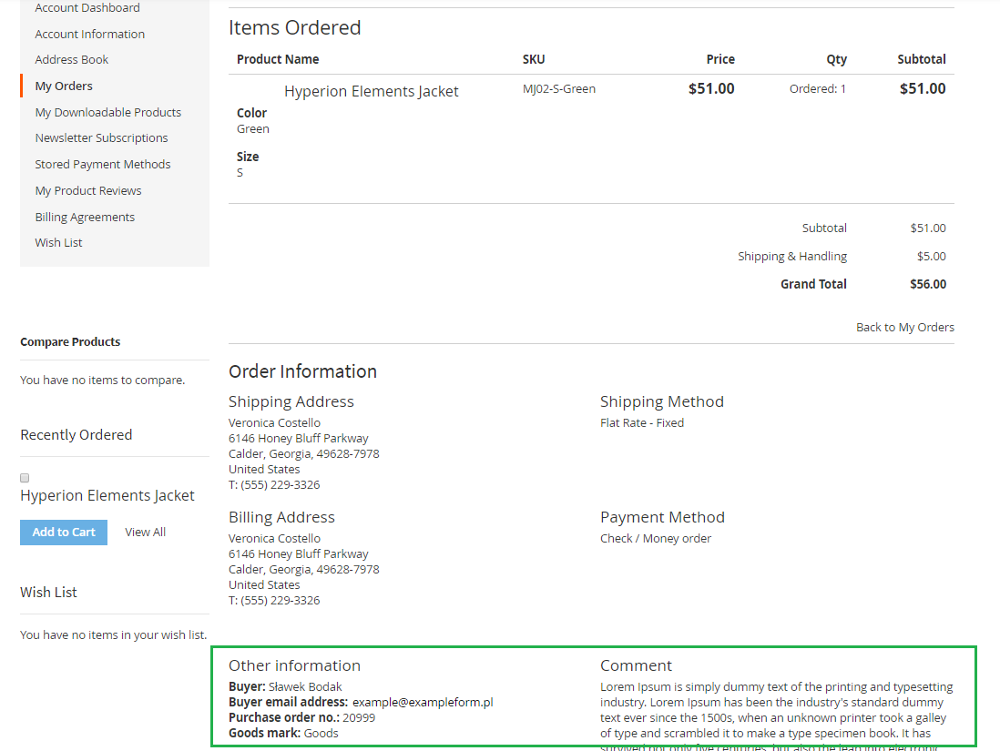
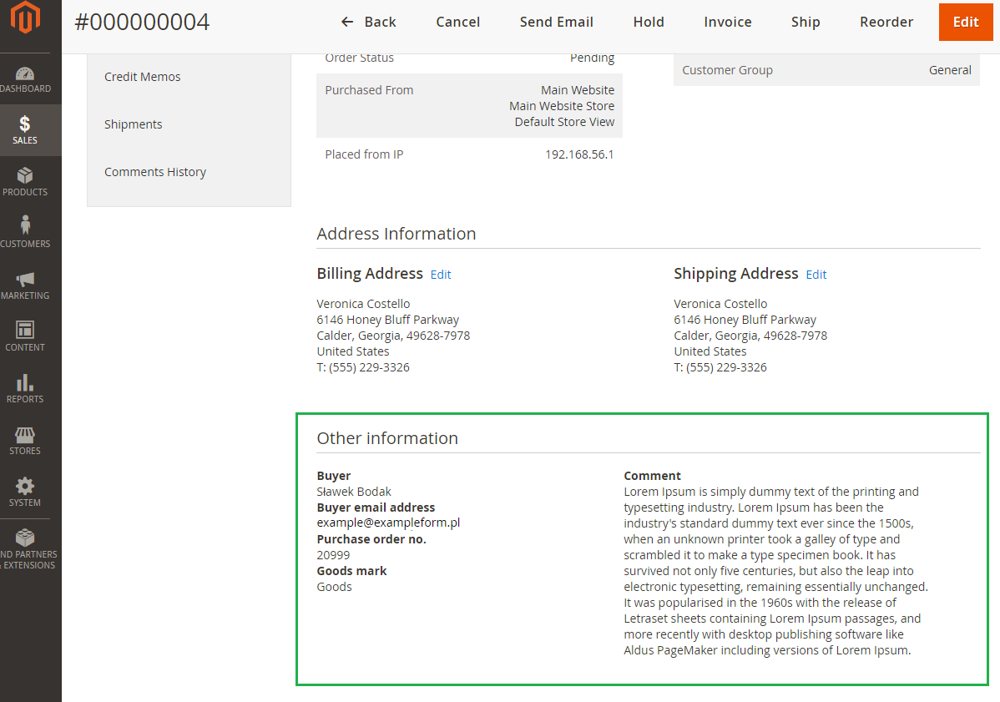

# Magento 2 – Checkout Custom Form

## Overview

Adds a configurable custom form to the Magento 2 checkout (shipping step), placed above the shipping-method selection.  
The form works for both logged-in customers and guests.  
After an order is placed, all entered data is stored in the `sales_order` table and exposed via extension attributes on `OrderInterface`.  
Form data persists through page refreshes as long as the cart is active.

Fields can be individually **enabled or disabled per store view** from the admin panel.  
Optional **character-length limits** can be configured for each field.

### Default form fields

| Field | Config key |
|---|---|
| Buyer name | `checkout_buyer_name` |
| Buyer email | `checkout_buyer_email` |
| Purchase order no. | `checkout_purchase_order_no` |
| Goods mark | `checkout_goods_mark` |
| Comment | `checkout_comment` |

### API endpoints

| Method | Endpoint | Auth |
|--------|----------|------|
| `PUT` | `/V1/carts/mine/set-order-custom-fields` | Customer |
| `PUT` | `/V1/guest-carts/:cartId/set-order-custom-field` | Guest |

---

## Compatibility

| Module version | Magento | PHP |
|---|---|---|
| `2.0.*` | 2.4.6 – 2.4.8 | 8.1 · 8.2 · 8.3 · 8.4 |
| `1.2.*` | 2.3.x | 7.x |
| `1.1.*` | 2.1.x – 2.2.x | *(no longer supported)* |

---

## Installation

```bash
composer require sbodak/magento2-checkout-custom-form
php bin/magento module:enable Bodak_CheckoutCustomForm
php bin/magento setup:upgrade
php bin/magento setup:di:compile
php bin/magento cache:flush
```

---

## Admin Configuration

Go to **Stores → Configuration → Sales → Checkout → Checkout Custom Form Configuration**.

- **Enabled Form Fields** – multiselect; choose which fields appear in the checkout.
- **\*\* Character Limit** fields – optionally restrict the maximum length of each field (leave empty for no limit).

---

## Customisation

### Adding / removing fields

1. Add the constant to `Api/Data/CustomFieldsInterface.php` and the `ATTRIBUTES` array.
2. Add the column to `Setup/Patch/Data/AddCustomFields.php`.
3. Extend `Model/Data/CustomFields.php` with getters, setters, and `isXxxEnabled()`.
4. Register the field in `Model/Config/Source/Option.php`.
5. Add it to `Model/Checkout/LayoutProcessor/Plugin.php` (`$fields` array).
6. Update `Observer/AddCustomFieldsToOrder.php` if custom mapping is required.
7. Update `Observer/Sales/OrderLoadAfter.php` to populate the extension attribute.
8. Update templates in `view/adminhtml/templates/order/view/custom_fields.phtml`
   and `view/frontend/templates/order/view/custom_fields.phtml`.

### Making a field required

In `Model/Checkout/LayoutProcessor/Plugin.php`, add a `validation` key to the field array:

```php
[
    'dataScopeName' => CustomFieldsInterface::CHECKOUT_PURCHASE_ORDER_NO,
    'label'         => 'Purchase order no.',
    'validation'    => ['required-entry' => true],
],
```

### Overriding translations

Edit `i18n/en_US.csv` (or create a language-specific CSV, e.g. `de_DE.csv`).

---

## Screenshots

### Checkout – Guest


### Checkout – Logged in


### Customer account – Order history


### Admin panel – Order edit


---

## Running Tests

```bash
composer install
vendor/bin/phpunit
```

---

## Uninstall

```bash
php bin/magento module:uninstall Bodak_CheckoutCustomForm
```

This drops the custom columns from the `sales_order` and `quote` tables.

---

## Changelog

See [CHANGELOG.md](CHANGELOG.md).

## License

[MIT License](LICENSE)
